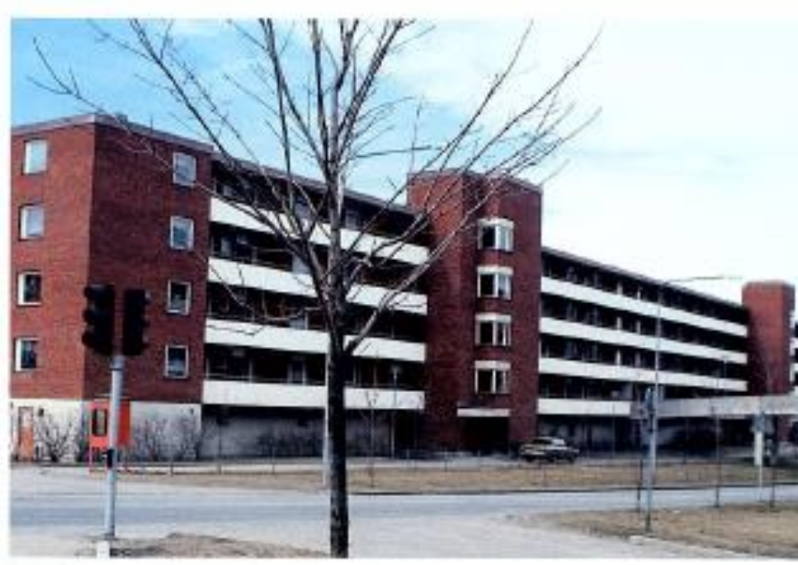
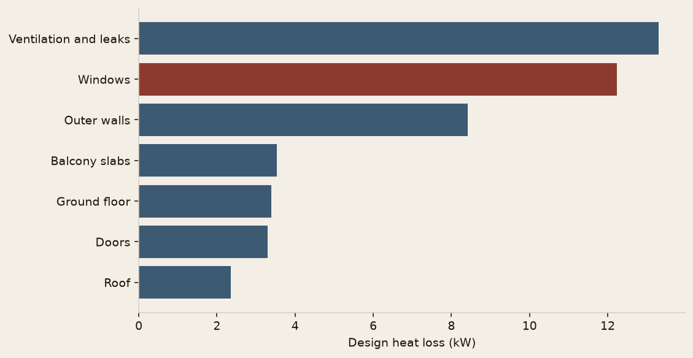

# The building goes cold before the heating can catch up

| | |
|---|---|
| **Role** | BI |
| **Domain** | Buildings |
| **Stack** |    |
| **Level** | Intermediate |
| **Status** | v1.0 |

A housing association in Danderyd, just north of Stockholm, cannot hold 20 °C indoors when the weather is really cold. This study sizes the heating for that day, then reads the energy label on a normal year.

The case is course ETA013 at the University of Gävle. The birth date 29 August 1986 fixes the variant: city 29, weather year 2017, indoor setpoint 22 °C, air-to-air heat pump with COP 3.



## Result

On the design day, **−10.7 °C**, the building needs **46.5 kW** if no internal gains are counted (41 kW if the appliances are on). The shell's average U-value is **0.59 W/(m²·K)**, above the 0.40 limit for a new Swedish multi-family building.

Over a normal year the heating deficit is **82 MWh**. The primary energy number is **108 kWh/m²·year**, energy class **E**. Hot water, still a plain electric cylinder, weighs more in that number than the space heating, because the heat pump only covers the radiators.



Recovering heat from the exhaust air, replacing the windows, and breaking the balcony slabs move the label from E to D. They do not reach C: the electric hot water stays in the bill.

The course report, typeset for submission, is [`docs/report/assignment-report.pdf`](docs/report/assignment-report.pdf) (LaTeX source next to it). The same write-up in Markdown, easier to diff, is [`docs/report/assignment-report.md`](docs/report/assignment-report.md).

## Data

| Piece | What it is |
|---|---|
| City | Danderyd, city number 29. The numbered list was not in the PDF; numbering follows the SMHI places in the Boverket DVUT file, with Abisko left out, so that number 14 is Bjurholm. |
| Design temperature | DVUT 1991–2020, 7-day value, matching a time constant of 6.7 days. |
| Weather year | Sveby / SMHI hourly file for 2017 (2015 + a + a + c). |
| Normal year | Sveby typical year 1991–2020, same place. |
| Solar | Monthly values read from Figure 1 of the brief (Örebro, 60° N). |

Only the hourly temperatures for this city are in the repo (`data/processed/`). The original Sveby archives are large and stay out of git. `data/reference/dvut_1991_2020.csv` is Boverket's open data.

## Reproduce

From the repository root, with Python 3.11 or newer:

```bash
python -m venv .venv
source .venv/bin/activate
pip install -e ".[dev]"
python -m building_energy.cli
pytest
```

The command rewrites the Markdown report, the figures, and `data/processed/results.json`. The birth date and the assumed conductivities live in `config/case.toml`.

To rebuild the PDF after a change to the LaTeX source:

```bash
cd docs/report && pdflatex assignment-report.tex && pdflatex assignment-report.tex
```

## Repo structure

```text
config/case.toml          birth date and the assumptions that are not in the brief
src/building_energy/      envelope, ventilation, hourly balance, energy class
data/processed/           Danderyd temperatures, 2017 and the typical year
data/reference/           DVUT table
docs/report/              the course report
docs/presentations/       Marp sources (recruiter and technical, FR and EN)
pictures/                 charts and the building photo from the brief
tests/                    formula checks and the full Danderyd case
```

`ROADMAP.md` and `JOURNAL.md` are in French, like the code comments.

## Presentations

Two audiences, two languages. The recruiter deck is a short pitch. The technical deck walks through the balance.

- [Recruiter overview (EN)](docs/slides/presentation-recruteur-en.html)
- [Technical deep dive (EN)](docs/slides/presentation-technique-en.html)
- [Présentation grand public (FR)](docs/slides/presentation-recruteur-fr.html)
- [Présentation technique (FR)](docs/slides/presentation-technique-fr.html)
