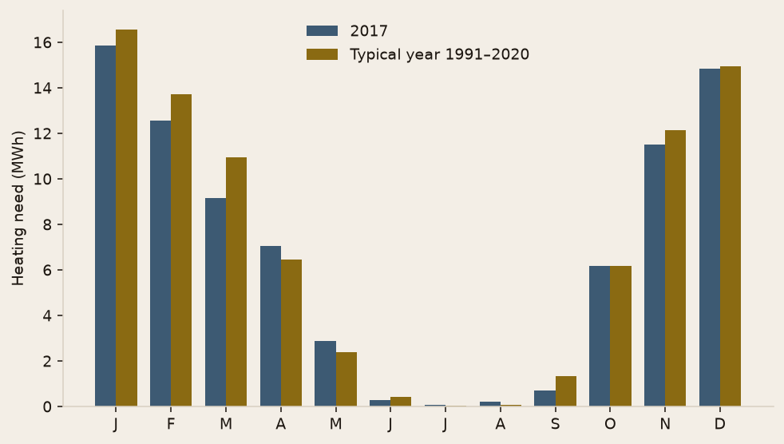

<!-- _class: cover -->
<!-- _paginate: false -->

# When it freezes,
# this building
# drops below 20 °C.

BI · Buildings

Danderyd · Sweden

---

<!-- _class: split -->

# The board calls
# when the flats
# go cold.

Three storeys, open corridors, old windows.

**Below 20 °C this is a heating failure, not a comfort setting.**

---

<!-- _class: split -->

# Someone has to
# pick the first
# repair.

The association pays. The engineer says what to change.

**Monday's question: glass, ventilation, or the balconies?**

---

<!-- _class: full -->

# Heat leaves
# by three paths.

The windows. The air the fans throw outside. The balcony slabs, which cut through the insulation.

---

<!-- _class: split -->

# We read one year,
# hour by hour.

Danderyd's weather in 2017, then the same building brought back to a normal climate, 1991–2020.

**The energy label is not the story of one lucky winter.**

---

<!-- _class: dark -->

# This sizes
# the heating.

The power to hold on a design day. The label on a normal year.

A study for the board. No 3D model, no contractor quote.

---

<!-- _class: full -->

# 47 kW
# at −11 °C outside.

Energy label **E**. A new building has to reach C.

---

<!-- _class: chart -->

# On the design day, the exhaust air and the windows take the most heat.

---

<!-- _class: chart -->

# Winter carries the heating. In summer it stops.

---

<!-- _class: split -->

# Label E is not
# only about
# the radiators.

The heat pump cuts the heating bill by three. Hot water is still a plain electric cylinder.

**On the label, hot water weighs more than the heating.**

---

<!-- _class: actions -->

# Monday, three jobs.

**Recover the heat** in the exhaust air — the largest saving.

**Replace the windows** — the largest hole in the walls.

**Break the balcony slabs** off the warm floor — a bridge the survey already flagged.

Together they move the label from E to D.

---

<!-- _class: cta -->

# The numbers are in the report.

[Report](https://github.com/dimiphoton/building-energy-systems-project/blob/main/docs/report/assignment-report.md)

[Code](https://github.com/dimiphoton/building-energy-systems-project)
