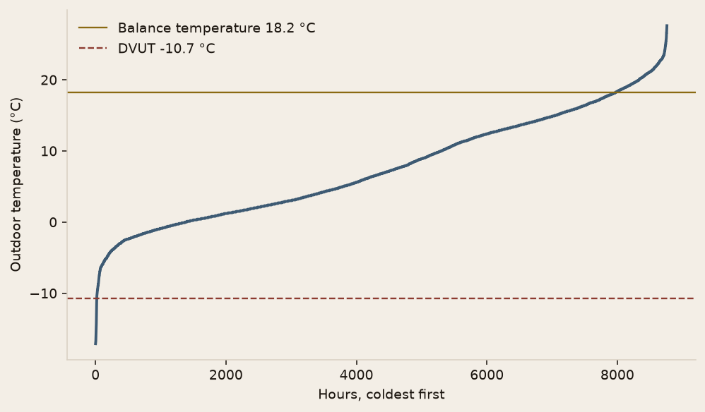
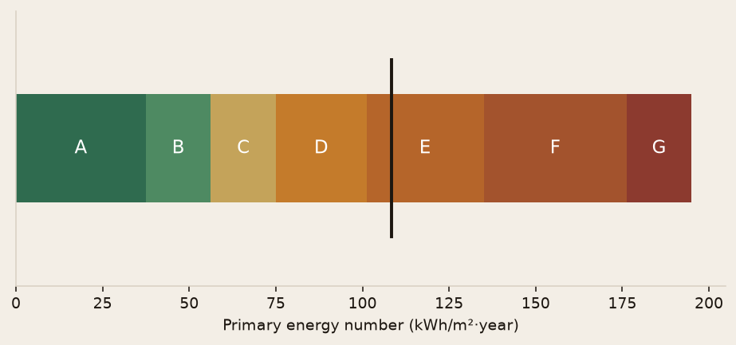

<!-- _class: cover -->
<!-- _paginate: false -->


# What power,
# and what label,
# in Danderyd?

BI · Buildings · Python / pandas / matplotlib

3 storeys · 1,350 m² · hourly · 2017

---

<!-- _class: split -->


# The symptom is
# a setpoint
# the building misses.

Below 20 °C in a cold spell, the emitters are short of power or the shell leaks too much.

**The brief asks for design power, then the energy class.**

---

<!-- _class: split -->


# The board and
# the HVAC office
# both use this.

The association ranks the works. The calculation follows course ETA013: DVUT, Um, heat deficit, primary energy.

**29 August 1986 fixes the city, the weather year and the heat pump.**

---

<!-- _class: full -->


# The corridors are
# slabs through
# the insulation.

Ψ = 0.6 W/(m·K) over 180 m. The wall, by the λ-value method, is U = 0.40. The windows are 2.9.

---

<!-- _class: split -->


# One hour,
# one temperature,
# one balance.

Sveby 2017 for Danderyd, 8,760 hours. Typical year 1991–2020 for the climate correction.

**Season fixed by the brief: 15 September to 15 May. Solar from the printed figure, not from the weather file.**

---

<!-- _class: split -->

# The design day
# is stripped of
# the free gains.

Design power: no sun, no people. The balance temperature keeps appliances only, 4 W/m².

**The seasonal deficit puts all three gains back in.**

---

<!-- _class: dark -->

# Scope, held.

Power at DVUT. Um. Seasonal deficit. Primary energy after a normal-year correction.

Steady state, hour by hour. No utilisation factor on the gains.

---

<!-- _class: chart -->

# DVUT is colder than almost every hour of 2017.



---

<!-- _class: full -->


# 46.5 kW
# at −10.7 °C.

Um = 0.589 W/(m²·K), above the 0.40 limit for a new building. Tb = 18.2 °C. Class **E**, 108 kWh/m²·year.

---

<!-- _class: chart -->

# Transmission is 1,016 W/K. Ventilation adds 407.


---

<!-- _class: split -->

# 2017 was slightly
# milder than
# the normal year.

Correction factor 1.019 on degree hours at base Tb. 80.2 MWh becomes 81.7 MWh.

**A direct run on the typical year gives 83.1 MWh. Same order.**

---

<!-- _class: chart -->

# Class E sits at 108. The new-building line is 75.



---

<!-- _class: split -->


# The heat pump
# covers space
# heat only.

COP 3, electricity weighted 1.8, F_geo = 1.0 in Danderyd.

**Inside EP: heating 36, hot water 45, property electricity 27.**

---

<!-- _class: dark -->

# Three limits,
# stated as such.

The city list was not in the PDF: number 29 is Danderyd. Solar was read off the figure, about ± 5 W/m². COP 3 is kept even at DVUT, which is optimistic.

---

<!-- _class: full -->


# Recovering the exhaust
# air saves more than
# the balcony bridge.

All three measures: about 60 MWh off, class D. Electric hot water is what keeps the building out of C.

---

<!-- _class: actions -->

# Levers, in megawatt-hour order.

**Exhaust air, 80 % recovery** — about 29 MWh.

**Glazing at U = 1.0** — about 26 MWh.

**Balcony Ψ down to 0.20** — about 8 MWh.

---

<!-- _class: cta -->


# Run it again.

```bash
pip install -e ".[dev]"
python -m building_energy.cli
pytest
```

[Code](https://github.com/dimiphoton/building-energy-systems-project)


